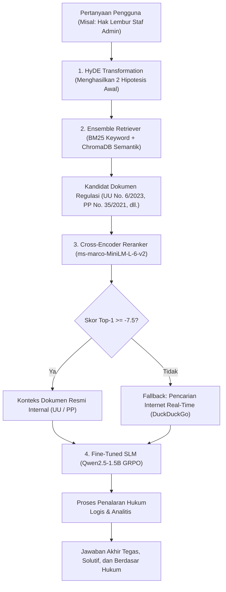

# ⚖️ Indonesian Legal AI Assistant: Fine-Tuned SLM (SFT & GRPO) with Advanced RAG

[](https://www.python.org/)
[](https://github.com/unslothai/unsloth)
[](https://huggingface.co/afihsan)
[](LICENSE)

Asisten AI spesialis hukum ketenagakerjaan dan korporasi Indonesia. Sistem ini dibangun dengan menggabungkan **Supervised Fine-Tuning (SFT)**, **Group Relative Policy Optimization (GRPO)** untuk menghasilkan proses penalaran eksplisit (*deep reasoning* di dalam tag `<think>...</think>`), serta **Advanced Retrieval-Augmented Generation (RAG)** berbasis regulasi resmi (UU Cipta Kerja No. 6/2023, PP No. 35/2021, PP No. 5/2021, dan PP No. 51/2023).

---

## 📌 Repositori Model Resmi (Hugging Face)

Model telah diunggah ke Hugging Face Hub (Public) dan siap di-load secara langsung untuk inferensi maupun fine-tuning lanjutan:

| Model | Tahapan Pelatihan | Tautan Hugging Face |
| :--- | :--- | :--- |
| **Qwen2.5-1.5B Legal SFT** | Supervised Fine-Tuning (QLoRA 4-bit) | [`afihsan/qwen2.5-1.5b-legal-chatbot-finetuned`](https://huggingface.co/afihsan/qwen2.5-1.5b-legal-chatbot-finetuned) |
| **Qwen2.5-1.5B Legal GRPO** | Reinforcement Learning with Deep Reasoning | [`afihsan/qwen2.5-1.5b-legal-chatbot-grpo`](https://huggingface.co/afihsan/qwen2.5-1.5b-legal-chatbot-grpo) |

---

## 🏛️ Arsitektur Sistem End-to-End



---

## 📚 Sumber Daya Dataset & Basis Dokumen Hukum

Untuk menjaga repositori tetap ringan dan efisien (< 1 MB), file biner dataset dan dokumen PDF tidak disimpan langsung di Git, melainkan dapat diakses melalui sumber resmi berikut:

### 1. Dataset Instruksi (Fine-Tuning & GRPO)
- **Sumber**: [`Ichsan2895/alpaca-gpt4-indonesian`](https://huggingface.co/datasets/Ichsan2895/alpaca-gpt4-indonesian)
- **Format**: Instruksi tanya-jawab gaya Alpaca berbahasa Indonesia.
- **Kurasi Domain Legal (GRPO)**: Notebook melakukan penyaringan otomatis dari 49.969 sampel umum menjadi **4.258 sampel prioritas hukum/ketenagakerjaan** menggunakan filter kata kunci regulasi (lembur, upah, pesangon, PHK, kepatuhan perusahaan) guna memfokuskan kemampuan penalaran model pada domain spesifik.

### 2. Dokumen Regulasi Knowledge Base (RAG)
Pipeline RAG memanfaatkan 4 dokumen perundang-undangan Republik Indonesia:
1. **UU No. 6 Tahun 2023**: Penetapan Perppu No. 2 Tahun 2022 tentang Cipta Kerja Menjadi Undang-Undang.
2. **PP No. 35 Tahun 2021**: Perjanjian Kerja Waktu Tertentu (PKWT), Alih Daya, Waktu Kerja dan Waktu Istirahat, serta Pemutusan Hubungan Kerja (PHK).
3. **PP No. 5 Tahun 2021**: Penyelenggaraan Perizinan Berusaha Berbasis Risiko.
4. **PP No. 51 Tahun 2023**: Perubahan atas Peraturan Pemerintah No. 36 Tahun 2021 tentang Pengupahan.

*(Pada lingkungan eksekusi, dokumen PDF ditempatkan di folder `./Document RAG/` atau di-mount via Kaggle Datasets).*

---

## 🛠️ Rincian 3 Pilar Implementasi

### 1. Supervised Fine-Tuning (SFT) — `fine-tuning-submission-pgabl-aaf-fatihul-ihsan.ipynb`
- **Arsitektur Model**: `unsloth/Qwen2.5-1.5B-Instruct`
- **Metode**: QLoRA (4-bit quantization, Double Quantization, FP16 compute).
- **LoRA Targets**: Seluruh modul Linear Attention & MLP (`q_proj`, `k_proj`, `v_proj`, `o_proj`, `gate_proj`, `up_proj`, `down_proj`).
- **Standardisasi Format**: ChatML (`<|im_start|>system...<|im_end|>`).
- **Hasil**: 62 cell output terekam lengkap dengan kurva training loss dan evaluasi checkpoint.

### 2. Reinforcement Learning via GRPO — `grpo-submission-pgabl-aaf-fatihul-ihsan.ipynb`
- **Trainer**: `GRPOTrainer` dari library TRL teroptimasi Unsloth FastRL (100 training steps, GPU T4).
- **Implementasi 4 Reward Functions Standar Rubrik**:
  1. `format_reward_func`: Reward shaping bertahap `<think>` (+0.2), `</think>` (+0.3). Saat format terdeteksi sempurna (diawali `<think>`, ditutup `</think>`, diikuti jawaban), skor **langsung di-override menjadi tepat +1.0** (tidak akumulatif), dengan penalti -0.5 untuk duplikasi tag.
  2. `reasoning_length_reward`: Evaluasi kedalaman penalaran berdasarkan panjang karakter isi tag `<think>` (0 char: 0.0; <50: +0.2; 50-199: +0.5; >=200: +1.0).
  3. `correctness_reward`: Evaluasi kesesuaian jawaban akhir menggunakan metrik standar industri **ROUGE-L** (`rouge-score`) dengan threshold 0.35.
  4. `language_reward_func`: Reward +1.0 untuk bahasa Indonesia baku, dan penalti -0.5 jika menghasilkan respons bahasa Inggris.

### 3. Advanced RAG Pipeline — `rag-submission-pgabl-aaf-fatihul-ihsan.ipynb`
- **HyDE Transformation**: Menghasilkan 2 hipotesis jawaban awal untuk mengatasi *lexical gap* antara pertanyaan pengguna dan bahasa formal undang-undang.
- **Ensemble Retriever**: Penggabungan pencarian kata kunci BM25 dan pencarian vektor semantik ChromaDB (`sentence-transformers/all-MiniLM-L6-v2`) dengan pembobotan seimbang.
- **Cross-Encoder Reranker**: Menggunakan `cross-encoder/ms-marco-MiniLM-L-6-v2` untuk menyaring dokumen kandidat menjadi Top-K terbaik.
- **Conditional Fallback**: Logika batas relevansi (`RELEVANCE_THRESHOLD = -7.5`). Jika dokumen internal tidak relevan, pipeline otomatis mencari data aktual via **DuckDuckGo Search**.
- **Sitasi Otomatis**: Menampilkan nama dokumen resmi dan nomor halaman sumber secara transparan.

---

## 🧪 Contoh Output Test Case Wajib

**Pertanyaan:**
> *"Saya staf admin, kemarin lembur 3 jam untuk beresin laporan. Apakah saya berhak dapat uang lembur?"*

**Output Inferensi Model GRPO:**
```text
======================================================================
HASIL TEST CASE WAJIB (MODEL GRPO):
======================================================================
Pertanyaan : Saya staf admin, kemarin lembur 3 jam untuk beresin laporan. Apakah saya berhak dapat uang lembur?

Jawaban Model (Reasoning & Final Answer):
<think>
Sebagai asisten AI hukum profesional spesialis regulasi ketenagakerjaan Indonesia (UU Cipta Kerja dan PP No. 35 Tahun 2021), saya akan memberikan jawaban yang jelas dan tegas tentang apakah Anda berhak mendapatkan uang lembur.

Dalam UU Cipta Kerja dan PP No. 35 Tahun 2021 Pasal 27 ayat (1), pengusaha yang mempekerjakan pekerja/buruh melebihi waktu kerja wajib membayar upah kerja lembur. Staf admin merupakan pekerja non-manajerial yang berhak atas kompensasi upah lembur.
</think>

Secara ringkas, jika Anda telah menunjukkan bahwa Anda memerlukan waktu lembur untuk menjalankan kewajiban Anda, maka Anda berhak mendapatkan uang lembur sesuai dengan peraturan yang berlaku. Namun, penting untuk dicatat bahwa lembur harus didasarkan pada perintah pengusaha dan persetujuan pekerja. Oleh karena itu, Anda harus menunjukkan bahwa Anda memerlukan waktu lembur untuk menjalankan kewajiban Anda.
======================================================================

 VERIFIKASI BERHASIL: Output menampilkan proses reasoning <think>...</think> dan jawaban final hukum!
```

---

## 🔒 Keamanan & Kebijakan Kredensial

Repositori ini menerapkan standar keamanan *clean code*:
- **Bebas Kredensial Sensitif**: Tidak ada token otentikasi (Hugging Face Token), API Key, maupun password yang ditulis secara langsung (*hardcoded*) di dalam script atau notebook.
- **Manajemen Secrets**: Otorisasi ke Hugging Face dilakukan secara aman menggunakan **Kaggle Secrets** (`UserSecretsClient().get_secret("HF_TOKEN")`) atau *Environment Variables* (`os.environ["HF_TOKEN"]`).
- **File `.gitignore`**: Memastikan seluruh file lokal temporer (`.env`, `.ipynb_checkpoints`, `__pycache__`) tidak terunggah ke repositori publik.

---

## 📁 Struktur Berkas

```text
├── fine-tuning-submission-pgabl-aaf-fatihul-ihsan.ipynb  # Notebook SFT (Hasil run Kaggle, 62 outputs)
├── grpo-submission-pgabl-aaf-fatihul-ihsan.ipynb         # Notebook GRPO (Hasil run Kaggle, 38 outputs)
├── rag-submission-pgabl-aaf-fatihul-ihsan.ipynb          # Notebook RAG Advanced (Hasil run Kaggle, 44 outputs)
├── requirements.txt                                      # Dependensi pustaka terpin
├── link_huggingface.txt                                  # Tautan repositori model Hugging Face
├── .gitignore                                            # Konfigurasi pengabaian file cache & temporary
└── README.md                                             # Dokumentasi lengkap proyek
```

---

## 👨‍💻 Profil Penulis

- **Nama**: Aaf Fatihul Ihsan
- **Program**: Coding Camp 2026 - AI Engineer (Proyek Akhir)
- **Hugging Face**: [@afihsan](https://huggingface.co/afihsan)
